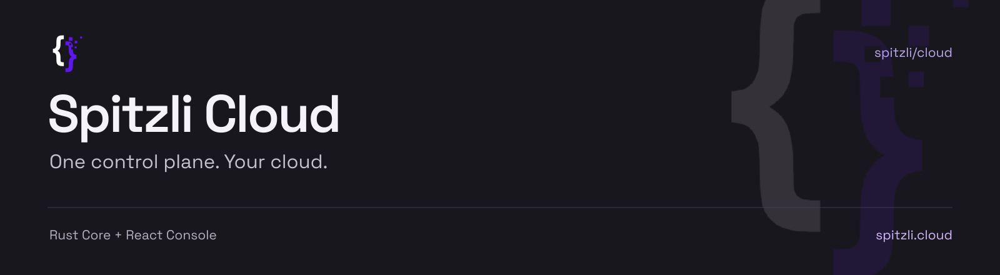
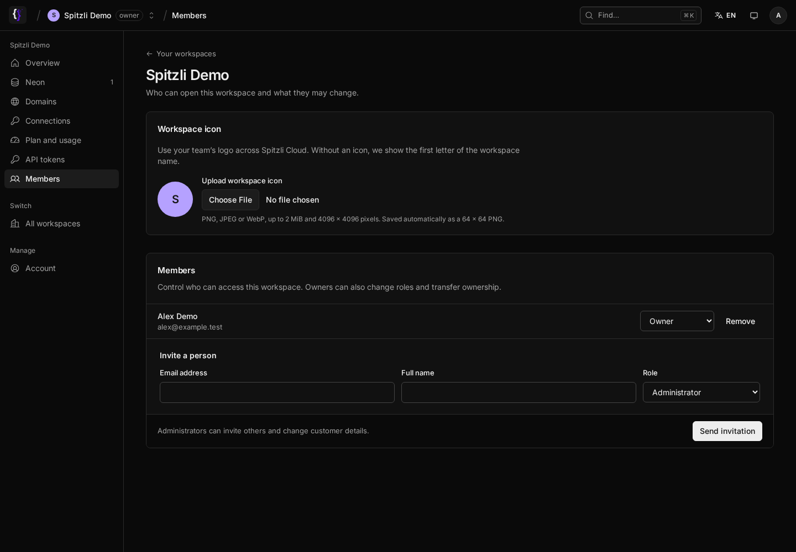

<p align="center">
  
</p>

<p align="center">
  <a href="https://spitzli.cloud">Website</a> ·
  <a href="https://console.spitzli.cloud">Console</a> ·
  <a href="https://docs.spitzli.cloud">Documentation</a> ·
  <a href="https://registry.spitzli.cloud">Plugin registry</a>
</p>

# Spitzli Cloud

Manage applications, databases and team access from one workspace. Spitzli Cloud combines a
Rust control plane, a React Console and product plugins that connect the services you choose.
Bring your own provider credentials; keep your projects and permissions in one place.

**Early access.** This is the active platform repository. Features are enabled deliberately per
workspace; code in this repository does not mean a product is publicly available. Preview
environments and billing are not released. Arbitrary public customer builds remain behind a
separate isolation and security qualification gate.



*Actual Console components, captured with synthetic demo data. No customer data or credentials
are shown. The workspace-icon controls are part of this branch; see the
[qualification record](docs/verification/2026-11-04-workspace-icons.json) for rollout status.*

## What lives here

- **Workspaces and projects:** member roles, customer plans, finite limits and usage, with separate
  operator and customer access.
- **Account security:** Neon Auth for the primary login, with Core-enforced account access, MFA
  and passkey support. [Account security](crates/identity/README.md).
- **Product plugins:** native Console screens backed by authorized plugin actions. Neon focuses
  on connecting existing databases, inspecting branches and revealing connection details on demand.
  Provider credentials remain behind Core. [Neon rollout](docs/operations/neon-plugin-rollout.md).
- **Git-based deployments:** a dedicated Kubernetes build backend and a separate workload runtime.
  Build success and deployment readiness have different lifecycles.
  [Git build guide](https://docs.spitzli.cloud/guides/git-deployments).
- **Workspace API:** scoped tokens for scripts and CI, subject to the same membership and limits.
  [API guide](docs/workspace-api.md).

Product plugins are developed in separate repositories under the
[Spitzli GitHub organization](https://github.com/spitzli). The `plugins/` directory also contains
compatibility sources and local fixtures; it is not the authoritative list of published products.
Customer websites retain their own repositories, deployments and content stores.

## Local development

Use the pinned Rust toolchain from [`rust-toolchain.toml`](rust-toolchain.toml), **Bun 1.4.3**,
**Node.js 24**, Docker and Tilt.

```sh
bun install --frozen-lockfile
bun run dev
```

Tilt starts the local database, Rust services, Console and account UI. Console listens on
`http://127.0.0.1:3121`, account UI on `http://localhost:3125`, and Core on port `3130`.
Generated private configuration stays in `.dev-local/`; development email goes to Mailpit.
Never use a customer database or real outbound email as a test fixture.

For separately configured processes:

```sh
bun run dev:api
bun run dev:console
bun run dev:auth
```

The public website is a separate application in `apps/website`; start it with `bun run dev:web`.
Local S3 tests use Tilt's retained MinIO volume: API `http://127.0.0.1:55900`, console
`http://127.0.0.1:55901`, path-style addressing. Its generated credentials are in
`.dev-local/minio.env`; this is development storage, not a customer storage offering.
See [Core development](crates/control-plane/README.md) and [Console development](apps/console/README.md).

## Checks

```sh
bun run quality                      # Native, contracts, frontend and local browser fixtures
bun run --cwd apps/console check       # Console TypeScript
bun run --cwd apps/console test        # Console unit tests
bun run --cwd packages/i18n catalog:check
bun run test:distribution             # Native distribution contracts
```

Database integration tests require explicitly owned, disposable local PostgreSQL fixtures.
A successful unit or browser-fixture run is not evidence of a production rollout. Dated
[verification records](docs/verification) separate local checks, deployed versions and remaining gates.
Spitzli's GitHub CI uses [Blacksmith](tools/plugin-ci/BLACKSMITH.md).

## Architecture and operations

| Location | Responsibility |
| --- | --- |
| `crates/control-plane` | Core HTTP API, account/OAuth protocols and orchestration |
| `apps/console` | React Console and account screens; Vite |
| `apps/website` | Public website; Next.js |
| `crates/agent`, `crates/agent-control` | Authorized workload execution and reporting |
| `crates/build` | Durable build lifecycle and Kubernetes execution |
| `crates/plugin-host`, `crates/plugin-runtime` | Plugin admission, limits, pinned workloads and RPC |
| `crates/persistence` | Native schema, migrations and restricted-role persistence |
| `deploy/` | Container, Compose and Helm definitions |
| `legacy/` | Retired TypeScript applications and historical tooling |

The managed installation separates Core, the customer run cluster and the build cluster.
Console and Auth frontend artifacts are built separately and hosted on Vercel. Core can also
serve first-party UI artifacts for separately configured installations. Keep deployment
configuration explicit; do not infer the production topology from a local Compose file.

Build the standalone backend image from the repository root:

```sh
docker build -f deploy/docker/backend.Dockerfile --target backend -t spitzli-cloud-core:local .
```

The image contains the runtime and independent migration/bootstrap tools. Runtime startup does
not migrate schemas or create operator credentials. Use restricted runtime database roles and
separate offline migration credentials. See [native setup](crates/control-plane/README.md),
[runtime configuration](crates/control-plane/.env.example), and
[signed plugin installation](docs/operations/native-plugin-installation.md).

The older Next.js Console/Auth and TypeScript control plane are archived under `legacy/` and
excluded from the active Bun workspace. They are historical references, not alternate production
entry points. Some internal package names and protocol identifiers still use `webdock` for
compatibility; preserve registered OAuth issuers, audiences, clients and existing encryption keys.
Platform IDs are decimal Snowflake **strings**.

Incoming mail is explicitly enabled per customer, using an isolated Stalwart Community Edition
instance. Outgoing-only customers do not receive Stalwart. Suspension retains data; deletion is
a separate action. See the [mail deployment decision](docs/architecture/mail-deployment-decision.md).

## Contributing and license

Read [CONTRIBUTING.md](CONTRIBUTING.md) before contributing. Preserve tenant isolation, use real
provider access only when explicitly authorized, and keep secrets out of source, logs and screenshots.
[Repository graphics and screenshot provenance](docs/images/repository/README.md) are documented
alongside the assets.

Original Spitzli Cloud code is **AGPL-3.0-only**. See [LICENSE](LICENSE) and
[alternative licensing](COMMERCIAL-LICENSING.md). Third-party components retain their own licenses.
